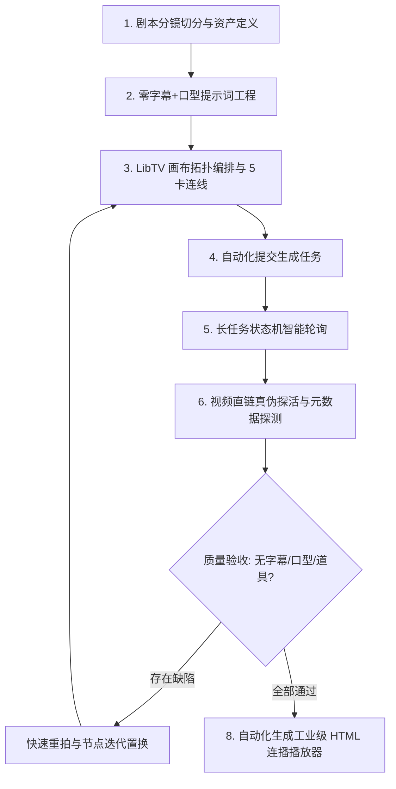

# AI 短剧工业级全流程智造引擎 (AI Drama Craftsman)

> 本技能包基于实战爆款微短剧《爆笑变形记》（7大场次、60个镜头、13分钟全链路）成功出片经验与全部避坑技术攻坚沉淀，旨在为任何团队或个人提供**标准化、零失误、可自动化的 AI 竖屏微短剧出片工作流**。

---

## 什么时候使用本 Skill

- 用户需要将文学剧本或大纲转化为**工业级 9:16 竖屏短剧视频**。
- 用户在使用 **LibTV 画布**、**Seedance 2.0 fast / 2.5** 等视频模型进行分镜批量生产与自动化调度。
- 生成的视频频繁出现**生硬黑条字幕、乱码汉字、角色闭嘴面瘫、关键道具或水果物种混淆**等质量缺陷需要解决。
- 需要自动化监控长耗时生成任务、提取 100% 有效视频直链（避开 404 哈希失效），并自动打包为高交互的 HTML 连播播放器。

---

## 核心生产工作流协议 (8-Stage Workflow Protocol)



### Stage 1: 剧本分镜切分与资产定义
- 将剧本切分为 4s / 9s / 14s 标准时长档位。
- 提取并固定 5 类核心视觉资产：主角1、主角2、场景环境、核心道具、调性参考。

### Stage 2: 零字幕 + 张嘴口型提示词工程
- **铁律 1（去字幕）**：正向词彻底剔除台词文字、说话者前缀与引号，转化为肢体与神态描述；负向词强效注入 `subtitles, text, words, watermark, caption, typography, Chinese characters, black bars...`。
- **铁律 2（口型动势）**：显式注入唇部与下颌运动描述：`(mouth naturally opens and closes speaking, animated jaw motion, expressive talking gestures)`，严禁静态闭嘴。

### Stage 3: LibTV 画布拓扑编排与 5 卡连线
- 自动化创建 `type: "video"` 节点，按 Y 轴固定间距（+480px）整齐排布。
- 自动化在 `edges` 中建立 5 条标准资产连线（`ref-1` 到 `ref-5`）。

### Stage 4 & 5: 任务提交与智能长轮询
- 触发生成任务，调用 `VideoTaskMonitor` 开展指数退避轮询，捕获生成进度（0%~100%）。

### Stage 6: 直链真伪探活与元数据实测
- 直接穿透 `canvas-full-flow.json` 提取最新生成的 `data.url[0]`。
- 使用 HTTP HEAD 探针确保 `status: 200` 且 `content-length > 1MB`。
- 在浏览器端利用 `HTMLVideoElement` 无依赖探测真实分辨率（9:16）与播放时长。

### Stage 7 & 8: 迭代置换与播放器交付
- 如遇镜头瑕疵（如字幕漏网、苹果混入脐橙），触发自动化重拍流程并无缝置换节点。
- 一键构建多镜头连续连播播放器（支持全屏、上下镜、自动切镜、倍速、直链一键下载）。

---

## 核心避坑专栏 (Pitfall Quick Reference)

| 痛点现象 | 核心根因 | 工业级解法 | 详见文档 |
| :--- | :--- | :--- | :--- |
| **画面长黑条中文字幕** | 正向词写了台词被模型拓印为视觉纹理 | 语义去词元化 + 动作神态置换 + 负向词全封锁 | [troubleshooting-guide.md](file:///references/troubleshooting-guide.md#避坑-1画面自动长出黑条中文字幕与乱码字体) |
| **角色面瘫闭嘴** | 视频模型无端到端TTS，默认输出低变动闭嘴帧 | 显式注入下颌与唇部张嘴运动描述 Token | [troubleshooting-guide.md](file:///references/troubleshooting-guide.md#避坑-2角色面瘫闭嘴后期对白无法贴合口型) |
| **果园长出红苹果** | 泛化词“果园”触发模型训练集高频先验 | 正向锁死金黄脐橙 + 负向全面拉黑苹果/草莓等 | [troubleshooting-guide.md](file:///references/troubleshooting-guide.md#避坑-3关键农产品道具物种混淆红苹果误现脐橙果园) |
| **视频直链 404** | 读取了历史重试任务的废弃哈希快照 | 穿透 `canvas-full-flow.json` 结合 HTTP HEAD 探针 | [troubleshooting-guide.md](file:///references/troubleshooting-guide.md#避坑-4视频直链-404-失效与-osscdn-哈希漂移) |
| **远端节点找不到** | React Flow 开启了视口虚拟化 (Unmount) | 利用 React Fiber 获取根实例，内存操作或平移视口 | [troubleshooting-guide.md](file:///references/troubleshooting-guide.md#避坑-5react-flow-画布远距虚拟化节点-dom-销毁-unmount) |

---

## 脚本工具箱使用指引

```bash
# 1. 节点参数组装与连线
node scripts/canvas_controller.mjs

# 2. 直链有效性与元数据检测
node -e "import('./scripts/verify_media_metadata.mjs').then(m => m.verifyRemoteUrl('https://...').then(console.log))"

# 3. 连播播放器生成
node -e "import('./scripts/build_series_player.mjs').then(m => m.generateDramaPlayer({ title: '第X场', videos: [...], outputPath: 'player.html' }))"
```
