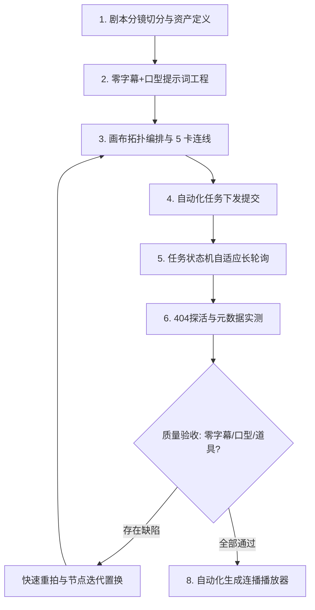

# AI 短剧工业级全流程智造引擎 (AI Drama Craftsman)

> 本技能包基于实战爆款微短剧《爆笑变形记》（7大场次、60个镜头、13分钟全链路）成功出片经验与全部避坑技术攻坚沉淀，提供一套**标准化、零失误、可自动化的 AI 竖屏微短剧出片工业流水线 (Standard Operating Procedure)**。

---

## 什么时候使用本技能 (When to Use)

- **场景 1（全流程制作）**：用户提供剧本文档或创意大纲，需要将其转化为**工业级 9:16 竖屏微短剧视频**。
- **场景 2（分镜与画布排布）**：在 **LibTV 画布** 或同类节点流平台中批量创建视频生成节点（如 Seedance 2.0 fast / 2.5），需要自动化编排节点拓扑与 5 卡资产连线。
- **场景 3（质量排错与深度避坑）**：视频生成中出现**生硬黑条字幕、乱码汉字、角色闭嘴面瘫（无法贴合配音口型）、果园长出红苹果（道具品类混淆）**等视觉缺陷，需采用工业级规范精准根除。
- **场景 4（交付与连播封装）**：需要对全剧多节点视频直链进行 **404 探活与元数据探测**，并自动生成可交互的 HTML 连播播放器。

---

## 核心生产工作流协议 (8-Stage Workflow Protocol)



### Stage 1: 剧本分镜切分与资产定义
- 参考 [shot_types.json](./resources/shot_types.json) 标准时长卡尺，严格将文学剧本切分为 **4s（极速反应）/ 9s（标准对白）/ 14s（戏剧长镜）**。
- 绑定 5 类核心视觉资产：主角1、主角2、场景环境、关键道具、镜头风格。规范参考 [character_card_template.json](./resources/character_card_template.json)。

### Stage 2: 零字幕 + 张嘴口型提示词工程
- **铁律 1（去字幕规范）**：正向词严禁写文学台词，转换为肢体神态。负向词必须强制注入 [negative_prompts.txt](./resources/negative_prompts.txt) 封杀黑条与文字。
- **铁律 2（张嘴口型控制）**：显式注入唇部与下颌动作 Token：`(mouth naturally opens and closes speaking, animated jaw motion, expressive talking gestures)`。
- 详细语法结构参见 [短剧提示词工程规范](./references/prompt-engineering-rules.md)。

### Stage 3: 画布拓扑编排与 5 卡连线
- 视频生成节点沿 Y 轴按固定步长（+480px）纵向排布，避免重叠。
- 自动化在拓扑中注入 5 条标准资产连线（`ref-1` 到 `ref-5`）。
- 底层实现详见 [LibTV 画布 React Flow 底层机制与虚拟化穿透指南](./references/libtv-reactflow-internals.md)。

### Stage 4 & 5: 任务提交与长轮询监控
- 触发生成后，调用 [poll_task_monitor.mjs](./scripts/poll_task_monitor.mjs) 监控生成进度（0%~100%）。

### Stage 6: 直链真伪探活与元数据实测
- 穿透 `canvas-full-flow.json` 提取最新 `data.url[0]`。
- 运行 [verify_media_metadata.mjs](./scripts/verify_media_metadata.mjs) 校验 `200 OK` 且体积大于 500KB，杜绝 404 失效哈希。
- 浏览器内核利用 `HTMLVideoElement` 零依赖校验真实宽高比与播放时长。

### Stage 7 & 8: 迭代置换与播放器交付
- 若镜头存在瑕疵，触发自动化重拍并替换对应节点。
- 调用 [build_series_player.mjs](./scripts/build_series_player.mjs) 自动组装为全功能连播 HTML 播放器（支持下一集无缝衔接、倍速调节、视频直链一键下载）。

---

## 核心避坑速查矩阵 (Pitfall Safeguards Matrix)

| 痛点现象 | 核心根因 | 工业级终极根治方案 | 深度剖析文档 |
| :--- | :--- | :--- | :--- |
| **画面长黑条中文字幕** | 扩散模型将正向词中的台词当成前景视觉纹理拓印 | **语义去词元化** + **动作神态置换** + **15+负向词全封锁** | [避坑指南 1.4](./references/troubleshooting-guide.md#避坑-1画面自动长出黑条中文字幕与乱码字体) |
| **角色面瘫闭嘴** | 视频模型无端到端TTS，默认输出低变动闭嘴帧 | **显式下颌与唇部张嘴运动指令 Token** | [避坑指南 2.3](./references/troubleshooting-guide.md#避坑-2角色面瘫闭嘴后期对白无法贴合口型) |
| **果园长出红苹果** | 泛化词“果园”触发模型训练集高频先验偏见 | **正向物种锁死** + **竞争物种负向全面拉黑** | [避坑指南 3.3](./references/troubleshooting-guide.md#避坑-3关键农产品道具物种混淆红苹果误现脐橙果园) |
| **视频直链 404** | 读取了历史重试任务的废弃哈希快照 | **实时数据流穿透溯源** + **自动化 HEAD 探针** | [避坑指南 4.3](./references/troubleshooting-guide.md#避坑-4视频直链-404-失效与-osscdn-哈希漂移) |
| **远端节点找不到** | React Flow 开启了视口虚拟化 (Unmount) | **React Fiber 内存穿透** 读取 `nodes` 并调用 `setCenter` | [避坑指南 5.3](./references/troubleshooting-guide.md#避坑-5react-flow-画布远距虚拟化节点-dom-销毁-unmount) |
| **具象短语误出字幕** | 正向中文具象短语触发字符生成头先验拓印 | **全英文视觉语法协议 (Visual English)** + **汉字全封锁** | [避坑指南 9.3](./references/troubleshooting-guide.md#避坑-9冷门具象中文短语触发汉字字符拓印以薅断老茶枝误出薅断老茶杵为例) |
| **14s 视频第 7 秒倒退** | 14s 双时序去噪窗口拼接处因果注意力回弹 | **单向时间流约束** + **黄金 9 秒单时钟窗口原则** | [避坑指南 10.3](./references/troubleshooting-guide.md#避坑-10超长视频-14s-滑动时序窗口拼接断层导致动作反向倒退) |
| **全景构图面部模糊** | 全景画面人物占比过低，8倍下采样丢失五官 Token | **中景跟推进阶** + **面部高清特化 Token 注入** | [避坑指南 11.3](./references/troubleshooting-guide.md#避坑-11全景构图面部像素稀释导致人物五官模糊) |
| **跑步失重与摔跤怪异** | 缺乏牛顿力学地面反作用力与摔跤生理缓冲因果链 | **生物力学动力学协议** + **4阶段跌倒缓冲生理时序链** | [避坑指南 12.3](./references/troubleshooting-guide.md#避坑-12ai-奔跑运动失重滑步与摔跤动作违背人体生物力学的动力学解法) |
| **茶水水位高于缺口** | “装满”等量词与容器开孔拓扑冲突，缺乏重力约束 | **流体静力学标高约束协议** + **负向防悬浮液面封锁** | [避坑指南 13.3](./references/troubleshooting-guide.md#避坑-13开口容器液体超限反重力悬浮以竹筒茶水水位高于侧面溢流切口为例) |
| **烟雾突兀消散又闪现** | 单镜头双空间跳切丢失发烟源上下文，缺乏累积扩散约束 | **连续介质气溶胶扩散协议** + **同画幅单机位运镜** | [避坑指南 14.3](./references/troubleshooting-guide.md#避坑-14多主体双场景跳切引发流体介质烟雾水汽时序湮灭与闪现) |


---

## 脚本工具箱使用指引 (Scripts & CLI)

本 Skill 提供全功能的 CLI 命令行工具 [scripts/cli.mjs](./scripts/cli.mjs)：

```bash
# 1. 验证视频直链存活状态与文件体积 (HEAD 探活)
node scripts/cli.mjs verify "https://.../video.mp4"

# 2. 根据分镜 JSON 模板一键构建连播播放器
node scripts/cli.mjs player examples/scene_templates/scene_template_sample.json output.html

# 3. 快速将文学台词转化为工业级无字幕+张嘴口型提示词
node scripts/cli.mjs prompt "阿福拍胸口保证一定给少爷安排最舒服的豪宅"
```

---

## 最佳实战档案参考 (Case Studies)

- 完整 7 大场次 60 镜头实战记录与连播播放器索引参见 [全剧 60 镜头实战蓝图](./references/full-drama-blueprint.md)。
- 样例工程与模板参见 [分镜配置示例](./examples/scene_templates/scene_template_sample.json) 与 [试看播放器](./examples/sample_players/demo_player.html)。
